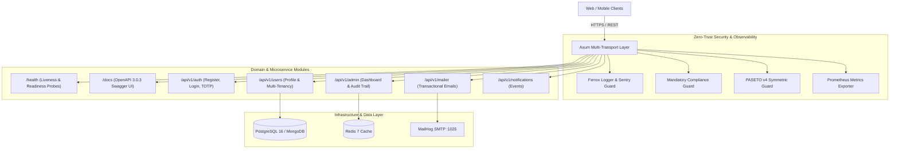

# 🦀 Ferrox Enterprise SaaS Backend

[](https://rust-lang.org)
[](https://github.com/tokio-rs/axum)
[](#security)
[](http://localhost:8080/docs)

**`ferrox-saas-backend`** is the flagship multi-tenant SaaS reference backend of the Ferrox Rust Workspace. It provides enterprise security, tenant isolation, centralized configuration, and high-performance asynchronous execution.

---

## 🏛️ System Architecture



---

## 📋 API Route Table

| Method | Endpoint | Description | Auth Required |
|---|---|---|---|
| `GET` | `/docs` | Interactive Swagger UI | No |
| `GET` | `/docs/openapi.json` | OpenAPI 3.0.3 Specification | No |
| `GET` | `/health` | Basic Framework Health | No |
| `GET` | `/health/live` | Kubernetes Liveness Probe | No |
| `GET` | `/health/ready` | Kubernetes Readiness Probe (DB/Redis) | No |
| `POST` | `/api/v1/auth/register` | User Registration | No |
| `POST` | `/api/v1/auth/login` | PASETO v4 Token Issuance | No |
| `GET` | `/api/v1/users/me` | Current User Profile | Bearer Token |
| `GET` | `/api/v1/admin/dashboard` | Administrative Dashboard & Telemetry | Admin Role |
| `POST` | `/api/v1/mailer/send` | Transactional Email Dispatch | Bearer Token |
| `POST` | `/api/v1/notifications/push` | Publish User Notification | Bearer Token |

---

## 🚀 Quickstart & Docker Deployment

### 1. Run via Docker Compose (Recommended)
Spins up `saas-backend`, PostgreSQL 16, Redis 7, and MailHog:

```bash
cd apps/ferrox-saas-backend
docker-compose up --build -d
```

Service URLs:
- **API Server & Swagger UI**: `http://localhost:8080/docs`
- **MailHog Web UI**: `http://localhost:8025`
- **Postgres Database**: `localhost:5432` (db: `ferrox_saas`, user: `postgres`)
- **Redis Cache**: `localhost:6379`

### 2. Run Locally in Development
```bash
cargo run --bin ferrox-saas-backend
```

---

## ⚙️ Environment Configuration (`.env`)

| Variable | Default Value | Description |
|---|---|---|
| `FERROX_PORT` | `8080` | HTTP listen port |
| `FERROX_ENV` | `development` | Environment (`development`, `staging`, `production`) |
| `FERROX_JWT_SECRET` | `super_secret...` | 32-byte symmetric key for PASETO v4 local tokens |
| `FERROX_DB_ENGINE` | `sql` | Database engine (`sql` for Postgres, `nosql` for Mongo) |
| `DATABASE_URL` | `postgres://...` | Connection URI for relational database |
| `REDIS_URL` | `redis://127.0.0.1:6379` | Redis connection URI |
| `SENTRY_DSN` | `""` | Optional Sentry DSN error tracking URI |

---

## 📡 API Testing & `curl` Examples

### 1. Health Probes
```bash
# Liveness Probe
curl -i http://localhost:8080/health/live

# Readiness Probe
curl -i http://localhost:8080/health/ready
```

### 2. Interactive Documentation
Open `http://localhost:8080/docs` in your browser to test endpoints directly via Swagger UI.

### 3. Register & Authenticate User
```bash
# Register User
curl -i -X POST http://localhost:8080/api/v1/auth/register \
  -H "Content-Type: application/json" \
  -d '{"email": "engineer@ferrox.dev", "password": "super_secure_password"}'

# Authenticate & Acquire PASETO Token
curl -i -X POST http://localhost:8080/api/v1/auth/login \
  -H "Content-Type: application/json" \
  -d '{"email": "engineer@ferrox.dev", "password": "super_secure_password"}'
```
