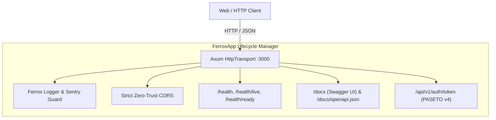

# 🦀 Ferrox Showcase Application

[](https://rust-lang.org)
[](https://github.com/tokio-rs/axum)
[](#security)
[](http://localhost:3000/docs)

**`ferrox-showcase`** is the lightweight reference application demonstrating the core primitives of the Ferrox Framework in pure Rust:
- Lifecycle management & multi-transport orchestrator (`FerroxApp`)
- Zero-Trust CORS isolation
- PASETO v4 local token generation
- Kubernetes-compliant `/health/live` and `/health/ready` probes
- Interactive Swagger UI documentation on `/docs`

---

## 🏛️ Showcase Architecture



---

## 📋 API Route Table

| Method | Endpoint | Description |
|---|---|---|
| `GET` | `/docs` | Interactive Swagger UI API Explorer |
| `GET` | `/docs/openapi.json` | OpenAPI 3.0.3 Schema Definition |
| `GET` | `/health` | Basic Healthcheck |
| `GET` | `/health/live` | Kubernetes Liveness Probe |
| `GET` | `/health/ready` | Kubernetes Readiness Probe |
| `GET` | `/api/v1/auth/token` | Demonstration PASETO v4 Token Generation |

---

## 🚀 Quickstart & Docker

### 1. Launch with Docker Compose
```bash
cd apps/ferrox-showcase
docker-compose up --build -d
```
Access Swagger UI at `http://localhost:3000/docs`.

### 2. Run Locally in Development
```bash
cargo run --bin ferrox-showcase
```

---

## 📡 API Testing & `curl` Examples

```bash
# Check Liveness Probe
curl -i http://localhost:3000/health/live

# Check Readiness Probe
curl -i http://localhost:3000/health/ready

# Generate PASETO v4 Demonstration Token
curl -i http://localhost:3000/api/v1/auth/token
```
