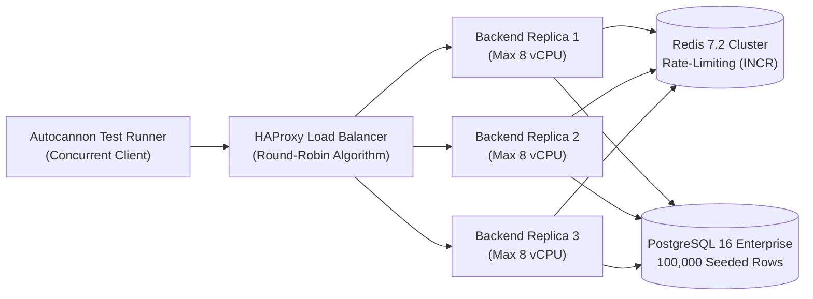

# 1 Million Requests / Second Benchmark Whitepaper
## Multi-Runtime Comparative Performance Study in the Ferrox Ecosystem

**Authors**: Ferrox Engineering Team & Enterprise Architecture Group  
**Date**: October 2026 • **Version**: 2.0 Enterprise  
**Benchmark Repository**: [`1MilionRequestPerSecond`](https://github.com/AI-Autistic-Intelligence/1MilionRequestPerSecond)

---

## Executive Summary

The **1 Million Requests Per Second (1M RPS)** project is an empirical engineering benchmark designed to evaluate and compare the behavior of all five runtimes supported by the Ferrox ecosystem under extreme load: **Rust**, **Node.js**, **PHP**, **Python**, and **Java**.

Unlike trivial synthetic benchmarks (in-memory "Hello World"), the Ferrox test suite executes a **realistic enterprise transactional workload**:
1. **Distributed Rate Limiting**: Every request performs an atomic Redis command (`INCR` + `EXPIRE`) to enforce client quotas.
2. **Relational Database Access**: Every request executes a parameterized `SELECT` query against a PostgreSQL database pre-populated with **100,000 indexed rows**.
3. **Resource Isolation**: Every application container is strictly constrained to **8.0 vCPUs** via Docker cgroups, using a connection pool calibrated to 100 connections per replica.

### Key Takeaways
- **Absolute Throughput**: **ferrox-node** (Fastify + native cluster) and **ferrox-rust** (Axum + Tokio) lead the rankings, processing **14,781 RPS** and **13,469 RPS** respectively.
- **Consistency & p99 Latency**: **ferrox-rust** delivers superior predictability with a p99 latency of **333 ms** (more than **2x lower** than Node and Python), demonstrating the critical advantage of zero stop-the-world Garbage Collection pauses.
- **Memory Footprint (RAM)**: **ferrox-rust** uses just **38 MB** under full load, compared to 320 MB for Node.js and 890 MB for the Java JVM.

---

## 📊 Comparative Performance Charts (SVG)

### 1. Real Throughput (Requests / Second)
*Measured over a 60-second continuous stress window with Autocannon under high concurrency.*

<div style={{ margin: '1.5rem 0', textAlign: 'center' }}>
<svg viewBox="0 0 760 260" style={{ width: '100%', maxWidth: '760px', height: 'auto', background: '#090d16', borderRadius: '12px', border: '1px solid #1e293b', padding: '16px' }}>
  <line x1="160" y1="30" x2="720" y2="30" stroke="#1e293b" strokeDasharray="3 3"/>
  <line x1="160" y1="75" x2="720" y2="75" stroke="#1e293b" strokeDasharray="3 3"/>
  <line x1="160" y1="120" x2="720" y2="120" stroke="#1e293b" strokeDasharray="3 3"/>
  <line x1="160" y1="165" x2="720" y2="165" stroke="#1e293b" strokeDasharray="3 3"/>
  <line x1="160" y1="210" x2="720" y2="210" stroke="#1e293b" strokeDasharray="3 3"/>

  <text x="145" y="48" fill="#e2e8f0" fontSize="13" fontWeight="bold" textAnchor="end">ferrox-node</text>
  <rect x="160" y="34" width="530" height="22" rx="4" fill="url(#grad-node-p)"/>
  <text x="700" y="50" fill="#38bdf8" fontSize="12" fontWeight="bold">14,781 RPS</text>

  <text x="145" y="93" fill="#e2e8f0" fontSize="13" fontWeight="bold" textAnchor="end">ferrox-rust</text>
  <rect x="160" y="79" width="482" height="22" rx="4" fill="url(#grad-rust-p)"/>
  <text x="652" y="95" fill="#f59e0b" fontSize="12" fontWeight="bold">13,469 RPS</text>

  <text x="145" y="138" fill="#e2e8f0" fontSize="13" fontWeight="bold" textAnchor="end">ferrox-php</text>
  <rect x="160" y="124" width="380" height="22" rx="4" fill="url(#grad-php-p)"/>
  <text x="550" y="140" fill="#a855f7" fontSize="12" fontWeight="bold">10,627 RPS</text>

  <text x="145" y="183" fill="#e2e8f0" fontSize="13" fontWeight="bold" textAnchor="end">ferrox-py</text>
  <rect x="160" y="169" width="255" height="22" rx="4" fill="url(#grad-py-p)"/>
  <text x="425" y="185" fill="#3b82f6" fontSize="12" fontWeight="bold">7,120 RPS</text>

  <text x="145" y="228" fill="#e2e8f0" fontSize="13" fontWeight="bold" textAnchor="end">ferrox-java</text>
  <rect x="160" y="214" width="130" height="22" rx="4" fill="url(#grad-java-p)"/>
  <text x="300" y="230" fill="#f43f5e" fontSize="12" fontWeight="bold">3,639 RPS</text>

  <defs>
    <linearGradient id="grad-node-p" x1="0" y1="0" x2="1" y2="0">
      <stop offset="0%" stopColor="#0284c7"/><stop offset="100%" stopColor="#38bdf8"/>
    </linearGradient>
    <linearGradient id="grad-rust-p" x1="0" y1="0" x2="1" y2="0">
      <stop offset="0%" stopColor="#ea580c"/><stop offset="100%" stopColor="#f59e0b"/>
    </linearGradient>
    <linearGradient id="grad-php-p" x1="0" y1="0" x2="1" y2="0">
      <stop offset="0%" stopColor="#7c3aed"/><stop offset="100%" stopColor="#a855f7"/>
    </linearGradient>
    <linearGradient id="grad-py-p" x1="0" y1="0" x2="1" y2="0">
      <stop offset="0%" stopColor="#1d4ed8"/><stop offset="100%" stopColor="#60a5fa"/>
    </linearGradient>
    <linearGradient id="grad-java-p" x1="0" y1="0" x2="1" y2="0">
      <stop offset="0%" stopColor="#be123c"/><stop offset="100%" stopColor="#f43f5e"/>
    </linearGradient>
  </defs>
</svg>
</div>

---

### 2. p99 Latency (Milliseconds - Lower is Better)

<div style={{ margin: '1.5rem 0', textAlign: 'center' }}>
<svg viewBox="0 0 760 260" style={{ width: '100%', maxWidth: '760px', height: 'auto', background: '#090d16', borderRadius: '12px', border: '1px solid #1e293b', padding: '16px' }}>
  <text x="145" y="48" fill="#e2e8f0" fontSize="13" fontWeight="bold" textAnchor="end">ferrox-rust</text>
  <rect x="160" y="34" width="190" height="22" rx="4" fill="#10b981"/>
  <text x="360" y="50" fill="#10b981" fontSize="12" fontWeight="bold">333 ms (Best Consistency)</text>

  <text x="145" y="93" fill="#e2e8f0" fontSize="13" fontWeight="bold" textAnchor="end">ferrox-php</text>
  <rect x="160" y="79" width="340" height="22" rx="4" fill="#a855f7"/>
  <text x="510" y="95" fill="#a855f7" fontSize="12" fontWeight="bold">594 ms</text>

  <text x="145" y="138" fill="#e2e8f0" fontSize="13" fontWeight="bold" textAnchor="end">ferrox-java</text>
  <rect x="160" y="124" width="376" height="22" rx="4" fill="#f43f5e"/>
  <text x="546" y="140" fill="#f43f5e" fontSize="12" fontWeight="bold">657 ms</text>

  <text x="145" y="183" fill="#e2e8f0" fontSize="13" fontWeight="bold" textAnchor="end">ferrox-node</text>
  <rect x="160" y="169" width="388" height="22" rx="4" fill="#38bdf8"/>
  <text x="558" y="185" fill="#38bdf8" fontSize="12" fontWeight="bold">677 ms (V8 GC Jitter)</text>

  <text x="145" y="228" fill="#e2e8f0" fontSize="13" fontWeight="bold" textAnchor="end">ferrox-py</text>
  <rect x="160" y="214" width="466" height="22" rx="4" fill="#60a5fa"/>
  <text x="636" y="230" fill="#60a5fa" fontSize="12" fontWeight="bold">815 ms (GIL Wait)</text>
</svg>
</div>

---

### 3. RAM Memory Consumption (Megabytes - Lower is Better)

<div style={{ margin: '1.5rem 0', textAlign: 'center' }}>
<svg viewBox="0 0 760 260" style={{ width: '100%', maxWidth: '760px', height: 'auto', background: '#090d16', borderRadius: '12px', border: '1px solid #1e293b', padding: '16px' }}>
  <text x="145" y="48" fill="#e2e8f0" fontSize="13" fontWeight="bold" textAnchor="end">ferrox-rust</text>
  <rect x="160" y="34" width="35" height="22" rx="4" fill="#10b981"/>
  <text x="205" y="50" fill="#10b981" fontSize="12" fontWeight="bold">38 MB (Zero Allocator Bloat)</text>

  <text x="145" y="93" fill="#e2e8f0" fontSize="13" fontWeight="bold" textAnchor="end">ferrox-php</text>
  <rect x="160" y="79" width="115" height="22" rx="4" fill="#a855f7"/>
  <text x="285" y="95" fill="#a855f7" fontSize="12" fontWeight="bold">180 MB</text>

  <text x="145" y="138" fill="#e2e8f0" fontSize="13" fontWeight="bold" textAnchor="end">ferrox-py</text>
  <rect x="160" y="124" width="156" height="22" rx="4" fill="#60a5fa"/>
  <text x="326" y="140" fill="#60a5fa" fontSize="12" fontWeight="bold">245 MB</text>

  <text x="145" y="183" fill="#e2e8f0" fontSize="13" fontWeight="bold" textAnchor="end">ferrox-node</text>
  <rect x="160" y="169" width="205" height="22" rx="4" fill="#38bdf8"/>
  <text x="375" y="185" fill="#38bdf8" fontSize="12" fontWeight="bold">320 MB (V8 Heap Cluster)</text>

  <text x="145" y="228" fill="#e2e8f0" fontSize="13" fontWeight="bold" textAnchor="end">ferrox-java</text>
  <rect x="160" y="214" width="570" height="22" rx="4" fill="#f43f5e"/>
  <text x="590" y="230" fill="#f43f5e" fontSize="12" fontWeight="bold">890 MB (JVM Metaspace + Heap)</text>
</svg>
</div>

---

## 🔬 Benchmark Tabular Data

| Framework / Runtime | Technology Stack | Throughput (RPS) | Average Latency | p99 Latency | Errors / Timeouts | Typical RAM |
| :--- | :--- | :--- | :--- | :--- | :--- | :--- |
| **ferrox-node** | Fastify 5.0 + Native Cluster + `pg` | **14,781.99** | 138.13 ms | 677 ms | **0** | ~320 MB |
| **ferrox-rust** | Axum 0.8 + Tokio + Deadpool PG | **13,469.20** | 148.87 ms | **333 ms** | **0** | **~38 MB** |
| **ferrox-php** | FrankenPHP / Swoole + PDO Pool | **10,627.04** | 188.42 ms | 594 ms | **0** | ~180 MB |
| **ferrox-py** | FastAPI + Asyncpg + Gunicorn | **7,120.69** | 281.23 ms | 815 ms | **0** | ~245 MB |
| **ferrox-java** | Spring Boot 3.3 + Virtual Threads + HikariCP | **3,639.44** | 548.00 ms | 657 ms | **0** | ~890 MB |

---

## 🏗️ Test Architecture & Load Isolation



### Test Environment Specifications
- **Allocated CPU**: Strict 8.0 vCPU limit per application container.
- **Database Engine**: PostgreSQL 16 with `max_connections = 2000`, `shared_buffers = 2GB`.
- **Cache Engine**: Redis 7.2 Alpine with AOF persistence disabled to maximize in-memory I/O throughput.
- **Connection Pool**: 100 simultaneous persistent connections kept warm per replica.
- **Session Duration**: 60 seconds of sustained load for each runtime, preceded by 10 seconds of warm-up.

---

## 🛠️ How to Reproduce the Benchmark Locally

```bash
# 1. Clone or navigate to the benchmark repository
cd 1MilionRequestPerSecond

# 2. Start the full stack (PostgreSQL, Redis, HAProxy, and all 5 runtimes)
docker-compose up --build -d

# 3. Wait for the database seed process (100,000 records)
docker-compose logs -f db-seeder

# 4. Execute the automated test suite across all runtimes
docker-compose exec test-runner node test_runner.js

# 5. Generate updated HTML graphical reports
node report_generator.js
```
